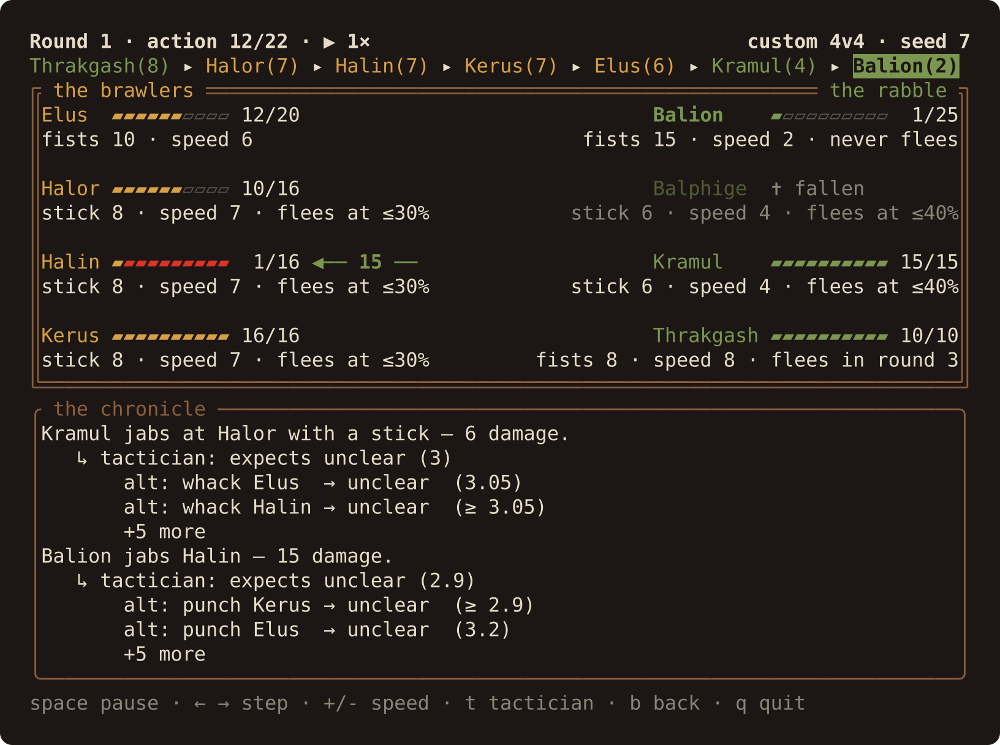

# Turn-based Auto-battling Experiments

This is a toy project for experimenting with game strategies in a turn-based combat,
akin to fights in role-playing games like Might & Magic 3/4/5, Eye of the Beholder,
Bard's Tale, etc.

... with the twist of having ✨Artificial✨Intelligence✨ select your turns.

---

This is definitely not rocket science being done here. Expect more minimax than AlphaZero.



## Example outcome

The following is an example of how the default ambush may unfold. (Names come from the seed, so
they change between runs; the ones below are the fixed names the narration tests use.)

We see the hero party, consisting of _Brull_, as well as the enemy party, consisting of _Ziuon_ and _Molphige_.
_Ziuon_ deals only 5 damage with their stick, but _Molphige_ deals 20 with their fists, which will take
_Brull_ out in one hit. Fights are played in rounds, and within a round the fastest combatant acts first.
_Brull_ is the fastest (speed 6), so the only viable option is to take _Molphige_ out before he can swing.

That is indeed what happens. With _Molphige_ down, _Ziuon_ sees no way to win and flees at once,
taking _Brull_'s parting blow on the way out; waiting any longer would only cost more.
The lines marked _tactician_ explain each choice: what the acting side expects, and the best
alternatives it passed up, with their scores from the initiator's point of view
(`≤`/`≥` mark bounds that alpha-beta pruning left open; `≈` marks a score whose true value could lie on either side of the number).

The block below is the `--plain` text log (`task run:plain`), the output a pipe or `--fast` gets.

```
⚔  Brull stands against Ziuon and Molphige.

══ Round 1 ══  initiative: Brull(6) → Molphige(5) → Ziuon(3)
Brull jabs Molphige — 10 damage. Molphige is down!
   ↳ tactician: expects they escape (2)
       alt: glare at Molphige → defeat  (≤ -20)
       alt: punch Ziuon       → defeat  (≤ -20)
       +2 more
Ziuon flees!
   ↳ tactician: expects escape (2)
       alt: whack Brull    → defeat  (≥ 10)
       alt: glare at Brull → defeat  (≥ 14)
Parting blow: Brull jabs Ziuon — 10 damage.
   ↳ tactician: expects they escape (2)
       alt: glare at Ziuon → they escape  (2)

  Brull     ████████████████████ 20/20
  Ziuon     ↩ fled
  Molphige  ✝ fallen

🏁 Ziuon fled; Brull holds the field after 1 round.
```

A line with search statistics follows at the end. Run it with `task run`; on a terminal it plays
back in the TUI (see below), `task run -- --plain` prints the text log instead, and
`task run -- --no-explain` leaves out the tactician notes.

## Watching a fight

On a terminal, `task run` opens a TUI on a scenario menu. Pick a scenario, press `enter` to see the
lineup while the fight is solved in the background, then `space` to watch it play: the standoff frame
with both sides' health bars and the log below them. Pipe the output, or pass `--fast` or `--plain` (`task run:plain`), and the
text log is printed instead. This is what the frame looks like at the first action:

```
Round 1 · action 1/3 · ⏸ 1×                                      ambush · seed 7
Brull(6) ▸ Molphige(5) ▸ Ziuon(3)
╔ the brawlers ════════════════════════════════════════════════════ the rabble ╗
║Brull ▰▰▰▰▰▰▰▰▰▰ 20/20                               Ziuon    ▰▰▰▰▰▰▰▰▰▰ 15/15║
║fists 10 · speed 6                                           stick 5 · speed 3║
║                                                                              ║
║                                           ── 10 ──▶ Molphige ✝ fallen        ║
║                                                            fists 20 · speed 5║
╚══════════════════════════════════════════════════════════════════════════════╝
╭ the chronicle ───────────────────────────────────────────────────────────────╮
│⚔  Brull stands against Ziuon and Molphige.                                   │
│Brull jabs Molphige — 10 damage. Molphige is down!                            │
│   ↳ tactician: expects they escape (2)                                       │
│       alt: punch Ziuon    → defeat  (≤ -20)                                  │
│       alt: glare at Ziuon → defeat  (≤ -20)                                  │
│       +2 more                                                                │
│                                                                              │
│                                                                              │
│                                                                              │
│                                                                              │
│                                                                              │
│                                                                              │
╰──────────────────────────────────────────────────────────────────────────────╯
space pause · ← → step · +/- speed · t tactician · b back · q quit
```

Menu:

- `↑` / `↓` (or `k` / `j`) move between the scenarios, the brawler and rabble counts, the roster and the seed.
- `←` / `→` (or `h` / `l`) change the value on that row.
- `0`-`9` and `Backspace` edit the seed on its row (the first key after arriving starts a new number); `r` rolls a new one.
- `enter` opens the lineup; `q`, `Esc` or `Ctrl-C` quit.

Lineup:

- `space` or `enter` begin the fight once it is solved (big parties can take a moment).
- `b` or `Esc` go back to the menu; `q` or `Ctrl-C` quit.

Fight:

- `space` pauses and resumes the fight.
- `←` / `→` (or `h` / `l`) step one action back or forward; stepping pauses the fight.
- `+` / `-` change the speed between 0.25× and 4×.
- `t` toggles the tactician notes.
- `b` or `Esc` go back to the menu; `q` or `Ctrl-C` quit.

After the fight ends the screen stays until you leave it, and `←` still steps back through it.
Terminals smaller than 80×24 show "terminal too small (needs 80×24)".

## Choosing a fight

The default fight is the ambush above. Other fights generate their parties from a seed: the same
seed builds the same stats and names on every run and machine. Runs without `--seed` pick one from
the clock and print it in the statistics line, so a good fight can be replayed.

| Command | Fight |
|---|---|
| `task run:scenarios` | List the presets |
| `task run:duel` | 1 hero vs 1 villain |
| `task run:skirmish` | 2 heroes vs 3 villains |
| `task run:brawl` | 3 heroes vs 4 villains |
| `task run:random HEROES=4 VILLAINS=2 SEED=7` | Any sizes from 1 to 4 per side; `SEED` is optional |
| `task run:plain` | Print the text combat log instead of the TUI (the default ambush) |

Every task takes extra flags after `--`, e.g. `task run:brawl -- --seed 42 --fast`. The flags:

- `--scenario NAME` picks a preset; `--heroes N` / `--villains N` generate custom sizes instead
  (a missing side defaults to 2 heroes or 3 villains).
- `--roster random` (default) rolls 10–25 health, fists (5–20 damage) or a stick (4–12) and speed
  1–9, plus a morale; `--roster archetypes` makes every member a Brawler, Fencer or Scout (heroes)
  or a Thug, Brute or Lurker (villains). The ambush keeps its fixed stats.
- Random rosters roll morale per member: 40% tactical, 20% never flees, 30% flees once their health
  drops to 10–60%, and 10% leave after 2–5 rounds. Archetypes have a fixed one: Brawler tactical,
  Fencer flees at 30%, Scout leaves after round 3, Thug flees at 40%, Brute never flees, Lurker
  leaves after round 2. The panel shows it next to the health bar.
- `--plain` prints the text combat log instead of opening the TUI (`--fast` does too, and so does piping).
- `--seed N` replays a fight; `--depth N` sets how many actions ahead the tactician looks (1–40,
  default 10). Large fights get slow above about 16.
- `--search KIND` picks how the tactician searches: `basic`, `pv`, `ordered`, `tt` or `mtdf` (default
  `tt`). Each kind adds a speedup to the one before and finds moves just as good, but where moves
  tie it may pick another one, so a seed can play out differently; `--search basic` replays fights
  as before. The stats line names the kind used.

**Comparing the searches.** `task bench:search` (or `cargo run --release -- --bench-search
--depth N`) searches a fixed set of positions with every kind and prints a table of evaluations
(also relative to `basic`), cuts and time, and how many positions each kind agrees with `basic`
on. At the default depth of 10 it reads like this (times vary from run to run and machine to machine):

```text
search bench · depth 10 · 37 positions
kind     evaluations  ×basic    cuts     time  match
basic         718408   1.00×  231946  153.0ms  37/37
pv            547197   0.76×  163258  112.7ms  37/37
ordered       440539   0.61×  156447  118.0ms  37/37
tt            248644   0.35×   77682   98.4ms  37/37
mtdf          239057   0.33×   77587  104.3ms  37/37
```

`tt` is the default: over five runs its median time was within about 2% of `mtdf`'s, too close
to call, so the simpler kind won.

Every combatant searches anew on their turn, so a fight plays on until one side wins or escapes,
however far that is beyond the lookahead. After 50 rounds it is called undecided.

Morale was added after seeds were first shared, so a seed from before that change builds a
different fight now.

## Rules of ~~Engagement~~ the Game

- [x] Two factions are fighting each other in rounds. In every round each combatant acts once,
  in initiative order by speed (fastest first; ties: the initiating party first, then the lower member id).
- On their turn, each combatant picks one action. Such an action can be,
  - [x] Attacking a single opponent,
  - [ ] Attacking a group of opponents (area effects),
  - [ ] Applying an effect to a party member,
  - [ ] Skip the turn, i.e. do nothing.
- In addition, a combatant can flee on their own, and the faction as a whole can order a retreat.
  - [x] Every flight costs: each enemy who can still act lands one parting blow, fastest first,
    then the round carries on without the fugitives.
  - [x] Fled fighters are out of the fight for good; the fight ends once a whole side has fled or fallen.
  - [x] Morale decides who flees without being told to: *tactical* fighters flee only when the AI
    says so or the party retreats, *never* fighters never flee and hold the line when the party
    retreats, *courage* fighters flee once their health drops to a threshold, and some leave
    after a number of rounds.
  - [x] The AI counts a fled fighter at half their health when scoring a position.
- [ ] Party members can be paralyzed or attack their own faction.
 
As for actions,

- [x] Some actions are instantaneous (attacking an enemy),
- [ ] Some actions take preparation (e.g. preparing a magic spell),
- [ ] Some actions have requirements (e.g. a potion must exist to be used)

## How the tactician picks a move

Both sides are played by the same search ([`src/search.rs`](src/search.rs)). It plays the
initiating party, the heroes, as the side that wants the score up. It assumes the other side
always answers with whatever hurts the heroes most.

**One move at a time.** Before every single action, the solver searches the tree of possible
continuations from the current state, plays only the first move of the best line it found, then
searches again from the new state. That repeats until one side has fallen or fled, or after 50
rounds (`Solver::play`).

**The tree.** Each level of the tree is one combatant's turn, in initiative order, so
consecutive turns of the same side are consecutive levels of the same kind. A heroes' turn is a
*max* node: pick the child with the highest score. A villains' turn is a *min* node: pick the
lowest. The children of a node are every action that combatant may take this turn:

- an attack on each enemy still on the field,
- fleeing alone, or ordering the whole party to retreat, only for *tactical* fighters whose party
  may retreat,
- nothing but fleeing for a fighter whose courage has broken,
- during parting blows, only attacks on the fighters who are just leaving.

**Scoring a position** ([`src/utility_value.rs`](src/utility_value.rs)) always takes the
heroes' point of view:

| Position                         | Score                                                     |
|----------------------------------|-----------------------------------------------------------|
| Heroes defeated                  | minus all damage the heroes took                          |
| Heroes all fled                  | a tenth of that, so retreating beats dying                |
| Villains defeated                | the heroes' remaining health, fled heroes at half         |
| Villains all fled                | a tenth of the remaining health                           |
| Undecided, search depth reached  | a tenth of the remaining health, as a guess               |

Scaling the open and partial outcomes by a tenth makes a clean win worth far more than a position
that merely looks good, so the heroes go for the kill when they can see it.

**Alpha-beta pruning.** The search runs depth-first and carries a window `[α, β]` down the
tree: α is the score the heroes are already sure of elsewhere, β the score the villains are
already sure of. As soon as a node's score falls outside that window, the side choosing above it
would never let the fight get here, so its remaining moves are skipped (a *cut*). A villain node
also stops as soon as it finds any line that defeats the heroes or drives them off, since that is
bad enough.

**Iterative deepening.** `--depth N` (default 10) caps how many actions ahead a search looks. The
solver first searches 1 action deep, then 2, and so on up to `N`. It stops early when a search
sees the whole fight to its end, or finds a win for the heroes, so easy positions stay cheap.

**The tactician notes.** After each search, the solver collects the other moves the acting
combatant tried, ranked from that combatant's point of view.
Those are the `↳ tactician: expects …` and `alt: …` lines in the log. A cut leaves a move's score
only partly known, which the log marks as `≥` or `≤`. The log shows the two best alternatives;
`+N more` counts the other ones that were tried, and `N not examined` the moves a cut skipped.

## Things to do

- [x] Regular minimax ([`src/search/alphabeta.rs`](src/search/alphabeta.rs)).
- [x] Rounds with speed-ordered initiative, one combatant per turn ([`src/action_iterator.rs`](src/action_iterator.rs)).
- [x] Implement Alpha-Beta pruning ([`src/search/alphabeta.rs`](src/search/alphabeta.rs)).
- [x] Implement Iterative Deepening.
- [x] Search the best line of the previous depth first when deepening (`--search pv`).
- [x] Order moves by a heuristic (e.g. the blow that drops the weakest enemy first), so cuts come
  earlier (`--search ordered`, [`src/search/ordering.rs`](src/search/ordering.rs)).
- [x] Cache positions already scored (a transposition table): hitting A then B and B then A meet
  again (`--search tt`, [`src/search/table.rs`](src/search/table.rs)).
- [x] Try MTD(f), the practical form of SSS\*, on top of that (`--search mtdf`,
  [`src/search/mtdf.rs`](src/search/mtdf.rs)).

A\* itself does not fit: it searches for the cheapest path when one side controls every move, and
here the villains answer every move with their worst. With the villains fixed to a simple rule,
the fight would become a path search A\* could run, but the only estimate of the remaining cost that
never overshoots is about zero, so A\* would do no better than a plain cheapest-first search, and
the fight would no longer be minimax. The best-first relatives built for two-player games, SSS\*,
B\* and proof-number search, are where the idea lives on, and MTD(f) (Plaat et al., 1996) explores
the same positions as SSS\* while needing far less memory.
